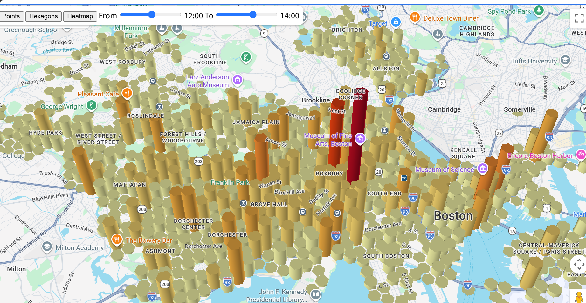

# Boston Crash Map

An interactive map of traffic crashes in Boston, built with [deck.gl](https://deck.gl) on Google Maps.
Switch between individual points, 3D hexagon bins, and a heatmap, and filter crashes by time of day.

<!-- Add a screenshot: save it as docs/screenshot.png -->


## Features

- **Three views:** points colored by crash type (motor vehicle, pedestrian, bicycle), extruded hexagon bins, and a heatmap.
- **Time-of-day filter:** pick a start and end hour, including ranges that cross midnight (for example 22:00 to 04:00).
- **Tooltips:** hover a point for crash type, location, and time; hover a hexagon for its crash count.
- **Live count** of crashes in the selected time range.

## How it works

- **Data pipeline.** `scripts/csv-to-geojson.js` converts the city's CSV into GeoJSON. It drops records outside Boston, rounds coordinates to 6 decimal places (about 0.1 m) to cut file size, and stores times in ISO UTC format. The app converts each time to the local hour in Boston.
- **Base map and layers.** deck.gl draws into the Google vector map's own WebGL context through `GoogleMapsOverlay` (interleaved mode), so the data layers stay in sync with the map, including tilt and rotation.
- **Filtering on the GPU.** The points layer uses `DataFilterExtension` with category filtering. The data never changes; only the list of visible hours does, so dragging the slider is cheap. Category filtering, rather than a numeric range, is what lets a range cross midnight.
- **Filtering on the CPU.** `HexagonLayer` aggregates on the CPU and does not support `DataFilterExtension`, and `HeatmapLayer` did not filter in this setup. Both get a pre-filtered array. The filter caches its last result, so deck.gl only re-aggregates when the hour range actually changes.

## Project structure

```
src/
  main.js      map setup, app state, and UI events
  data.js      loading crash data and the cached hour filter
  layers.js    deck.gl layers and tooltips
  filters.js   pure time-of-day helpers (unit tested)
  style.css
scripts/
  csv-to-geojson.js   converts the source CSV into public/crashes.geojson
tests/
  filters.test.js
```

## Getting started

You need Node.js 20 or later, a Google Maps API key, and a **vector** Map ID.

```bash
npm install
cp .env.example .env.local   # then add your API key and Map ID
npm run dev
```

Other scripts:

| Command | What it does |
| --- | --- |
| `npm test` | Run unit tests with Vitest |
| `npm run build` | Build for production into `dist/` |
| `npm run data` | Rebuild `public/crashes.geojson` from `boston_car_crash_data.csv` |

## Data

Crash records come from the City of Boston's [Vision Zero Crash Records](https://data.boston.gov/dataset/vision-zero-crash-records) dataset on Analyze Boston. To refresh the data, download the CSV, save it as `boston_car_crash_data.csv` in the project folder, and run `npm run data`.

## Next steps

- Move the app to React and TypeScript.
- Serve the data from a Django + PostGIS API and load only the area in view.
